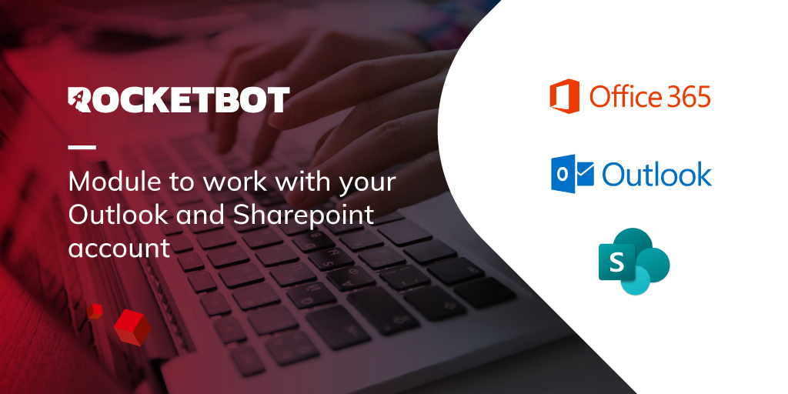

# O365
  
Conectate a tu cuenta de correo Outlook y a tu espacio de trabajo Sharepoint.  

*Read this in other languages: [English](Manual_O365.md), [Português](Manual_O365.pr.md), [Español](Manual_O365.es.md)*
  

## Como instalar este módulo
  
Para instalar el módulo en Rocketbot Studio, se puede hacer de dos formas:
1. Manual: __Descargar__ el archivo .zip y descomprimirlo en la carpeta modules. El nombre de la carpeta debe ser el mismo al del módulo y dentro debe tener los siguientes archivos y carpetas: \__init__.py, package.json, docs, example y libs. Si tiene abierta la aplicación, refresca el navegador para poder utilizar el nuevo modulo.
2. Automática: Al ingresar a Rocketbot Studio sobre el margen derecho encontrara la sección de **Addons**, seleccionar **Install Mods**, buscar el modulo deseado y presionar install.  

## Como usar este modulo

Antes de usar este módulo, es necesario registrar tu aplicación en el portal de Azure App Registrations. 

1. Inicie sesión en Azure Portal y busque el servicio Microsoft Entra ID.
2. En el menú lateral izquierdo, ingrese a "Registros de aplicaciones".
3. Seleccione "Nuevo registro".
4. En “Tipos de cuenta compatibles”, elija:
    - "Cuentas en cualquier directorio organizativo (cualquier directorio de Azure AD: multiinquilino) y cuentas de Microsoft personales (como Skype o Xbox)" para este caso utilizar  ID Inquilino = **common**.
    - "Solo cuentas de este directorio organizativo (solo esta cuenta: inquilino único) para este caso utilizar **ID Inquilino** especifico de la aplicación. (Recomendado para autenticación de aplicación)
    - "Solo cuentas personales de Microsoft " for this case use use Tenant ID = **consumers**.
5. Establezca la uri de redirección (Web) como: https://localhost:5001/ y haga click en "Registrar".
6. Copie el ID de la aplicación 
(cliente). Necesitará este valor.
7. Dentro de "Certificados y secretos", genere un nuevo secreto de cliente y establezca su caducidad. Copie el **VALOR** del secreto creado (**no el ID de secreto**), ya que se ocultará después de unos minutos.

### Tipos de autenticación

| Tipo | Inicio de sesión del usuario | Uso recomendado |
| --- | --- | --- |
| Delegada | Requerido para la primera conexión y cuando sea necesario volver a autorizar | Procesos que se ejecutan en nombre de un usuario |
| Aplicación | No requerido | Procesos desatendidos que utilizan una cuenta corporativa |

### Autenticación delegada

1. Dentro de "Permisos de API", seleccione "Microsoft Graph" > "Permisos delegados" y agregue:
    - `Mail.ReadWrite`
    - `Mail.Send`
    - `User.Read`
2. Para utilizar buzones compartidos, agregue también:
    - `Mail.ReadWrite.Shared`
    - `Mail.Send.Shared`
3. Si utilizará los comandos de SharePoint, agregue también:
    - `Group.Read.All`
    - `Sites.ReadWrite.All`
    - `Sites.Manage.All`
    - `Files.ReadWrite.All`
4. En Rocketbot Studio, inserte el comando "Conectar a O365" y complete:
    - Tipo de autenticación: `Delegada`
    - `client_id`
    - `client_secret`
    - `tenant_id`
    - `session`, si corresponde
5. Ejecute el comando. En la consola de Rocketbot se generará una URL de autorización. Cópiela y ábrala en su navegador.
6. Acepte los permisos solicitados. El navegador redirigirá a una página sin contenido. Copie la URL completa y péguela en la consola de Rocketbot debajo de **"Paste the authenticated url here:"**.
7. Presione Enter. Si la autenticación fue exitosa, verá en la consola: "Authentication Flow Completed. Oauth Access Token Stored. You can now use the API."

En la carpeta raíz de Rocketbot se creará un archivo de credenciales llamado `o365_token.txt` o `o365_token_{session}.txt`. Si el refresh token guardado es revocado o deja de ser válido, ejecute nuevamente el comando de conexión y complete la autorización con la nueva URL.

### Autenticación de aplicación (app-only)

La autenticación de aplicación está disponible únicamente para cuentas organizativas de Microsoft. No admite cuentas personales de Microsoft.

1. Dentro de "Permisos de API", seleccione "Microsoft Graph" > "Permisos de aplicación" y agregue:
    - `Mail.ReadWrite`
    - `Mail.Send`
2. Si utilizará los comandos de SharePoint, agregue también:
    - `Group.Read.All`
    - `Sites.ReadWrite.All`
    - `Sites.Manage.All`
    - `Files.ReadWrite.All`
3. Seleccione "Conceder consentimiento del administrador". Los permisos de aplicación requieren consentimiento del administrador.
4. En Rocketbot Studio, inserte el comando "Conectar a O365" y complete:
    - Tipo de autenticación: `Aplicación`
    - `client_id`
    - `client_secret`
    - `tenant_id` específico de la organización
    - `user_id`: nombre principal de usuario, por ejemplo `robot@empresa.com`, u Object ID del buzón que utilizará el robot
    - `session`, si corresponde
5. Ejecute el 
comando. Este tipo de autenticación no genera una URL de autorización ni requiere que el usuario inicie sesión.

La aplicación obtiene los access tokens utilizando sus propias credenciales. No utiliza un refresh token delegado. La opción "Habilitar buzón compartido" aplica únicamente a la autenticación delegada.

El `user_id` selecciona el buzón que utilizará el módulo, pero no limita los permisos concedidos a la aplicación. Si se debe restringir el acceso a buzones específicos, el administrador deberá configurar RBAC para aplicaciones en Exchange Online.

### Permisos adicionales para autenticación de Aplicación

En autenticación de Aplicación, los permisos se configuran directamente en Azure App Registrations. Los checkboxes **Conectarse a SharePoint** y **Habilitar buzón compartido** del comando de conexión solo agregan permisos delegados y no son necesarios en este modo.

Todos los permisos indicados a continuación deben agregarse desde:

1. Ingrese en **Azure Portal > App 
registrations**.
2. Seleccione la aplicación.
3. Ingrese en **API permissions**.
4. Seleccione **Add a permission > Microsoft Graph**.
5. Seleccione **Application permissions**.
6. Agregue los permisos necesarios.
7. Seleccione **Grant admin consent** para autorizar los permisos.

#### SharePoint

Para utilizar los comandos de SharePoint con autenticación de Aplicación, agregue los permisos según las operaciones que realizará el robot:

- `Sites.Read.All`: permite leer documentos y elementos de listas de SharePoint.
- `Sites.ReadWrite.All`: permite crear, leer, modificar y eliminar documentos y elementos de listas.
- `Sites.Manage.All`: necesario para crear o eliminar listas y bibliotecas de documentos.
- `Files.Read.All`: permite leer documentos.
- `Files.ReadWrite.All`: permite cargar, modificar, mover y eliminar documentos.
- `Group.Read.All`: necesario cuando el comando obtiene el sitio mediante el ID de un grupo de Microsoft 365.

No es necesario agregar todos los permisos si el 
robot no utilizará todas esas operaciones.

En el comando **Conectar a O365** deje desmarcado el checkbox **Conectarse a SharePoint**.

Como alternativa, puede utilizar el permiso `Sites.Selected` para limitar el acceso de la aplicación a sitios específicos. En ese caso, además de agregar el permiso y otorgar consentimiento de administrador, un administrador debe conceder acceso explícitamente a cada sitio.

Documentación oficial:

- [Microsoft Graph permissions reference](https://learn.microsoft.com/en-us/graph/permissions-reference)
- [Selected permissions in OneDrive and SharePoint](https://learn.microsoft.com/en-us/graph/permissions-selected-overview)

#### Buzones compartidos

Para utilizar buzones compartidos con autenticación de Aplicación, agregue los siguientes permisos:

- `Mail.Read`: permite únicamente leer correos.
- `Mail.ReadWrite`: permite crear, leer, modificar, mover y eliminar correos.
- `Mail.Send`: permite enviar correos.

Para utilizar todos los comandos de correo
 del módulo, agregue:

- `Mail.ReadWrite`
- `Mail.Send`

Los permisos `Mail.Read.Shared`, `Mail.ReadWrite.Shared` y `Mail.Send.Shared` corresponden únicamente a autenticación Delegada y no deben seleccionarse para autenticación de Aplicación.

Luego, en el comando **Conectar a O365** complete `user_id` con el UPN o el Object ID del usuario predeterminado. Si el robot trabajará únicamente con un buzón compartido, puede colocar el correo de ese buzón. Deje desmarcado el checkbox **Habilitar buzón compartido**.

En cada comando de correo que incluya el campo **Buzón compartido**, informe el correo del buzón sobre el que se realizará la operación. 

Los permisos de Aplicación de correo pueden otorgar acceso a todos los buzones de la organización. Si se requiere limitar el acceso a buzones específicos, el administrador debe configurar una política de acceso o Application RBAC en Exchange Online.

Documentación oficial:

- [Microsoft Graph permissions 
reference](https://learn.microsoft.com/en-us/graph/permissions-reference)
- [Role Based Access Control for Applications in Exchange Online](https://learn.microsoft.com/en-us/exchange/permissions-exo/application-rbac)

### Como filtrar correos

Para realizar filtro de correos deberá utilizar los siguientes Operadores y Funciones. 

1. __Equality operators__       
    - Igual (__eq__)
    - Diferente (__ne__)
    - Negación (__not__)
    - En (__in__)
    - Tiene (__has__)
2. __Relational operators__
    - Menor que (__lt__)
    - Mayor que (__gt__)
    - Menor o igual que (__le__)
    - Mayor o igual que (__ge__)
3. __Conditional operators__
    - Y (__and__)
    - O (__or__)
4. __Functions__        
    - Comienza con (__startsWith__)
    - Termina con (__endsWith__)
    - Contiene (__contains__)

Las principales propiedades que pueden utilizarse para realizar filtros son:

    "createdDateTime": "2022-10-24T13:14:24Z",
    "categories": [],
    "receivedDateTime": "2022-10-24T13:14:24Z",
    "sentDateTime": "2022-10-24T13:14:09Z",
    "hasAttachments": true/false,
    "importance": "",
    "isReadReceiptRequested": true/false,
    "isRead": true/false,
    "isDraft": true/false,
    "inferenceClassification": "",
    "body": {
        "contentType": "",
        "content": ""
    },
    "sender": {
        "emailAddress": {
            "name": "",
            "address": ""
        }
    },
    "from": {
        "emailAddress": {
            "name": "",
            "address": ""
        }
    },
    "toRecipients": [
        {
            "emailAddress": {
                "name": "",
                "address": ""
            }
        }
    ],
    "ccRecipients": [
        {
            "emailAddress": {
                "name": "",
                "address": ""
            }
        }
    ],
    "bccRecipients": [
        {
            "emailAddress": {
                "name": "",
                "address": ""
            }
        }
    ],
    "replyTo": [
        {
            "emailAddress": {
                "name": "",
                "address": ""
            }
        }
    ],
    "flag": {
        "flagStatus": ""
    }

Las mismas surgen del json de la respuesta a la consulta realizada a la API. Para revisar las propiedades de correos específicos puede ingresar a https://developer.microsoft.com/en-us/graph/graph-explorer ingresando con su cuenta de AZURE y realizar la consulta https://graph.microsoft.com/v1.0/me/messages/<ID_correo>.

Es importante tener presente que solo deben utilizarse comillas simples (') cuando se indique el valor a filtrar, salvo para el caso de valores booleanos (__true__ / __false__). A continuación se muestran ejemplos prácticos de cómo realizar filtros:

- Correos no leidos = __isRead eq false__
- Correos leidos = __isRead eq true__
- El Asunto es igual a... = __subject eq ‘example’__
- El Asunto contiene... = __contains(Subject, ‘example’)__
- El Asunto comienza con la palabra... = 
__startswith(Subject, ‘example’)__
- La fecha de recepción esta entre... = __ReceivedDateTime ge <date> and ReceivedDateTime le <date>__
- El cuerpo del correo contiene... = __contains(Body/Content, ‘example’)__
- El remitente del correo es igual a... = __From/EmailAddress/Address eq ‘example@example.com’__
- El remitente del correo comienza con... = __Startswith(From/EmailAddress/Address, ‘example’)__
- El correo tiene adjuntos = __HasAttachments eq true__

### Como identificar correos (ID)

Los correos se encuentran identificados con un ID único y dinámico. Esta última cualidad hace que si un correo cambia algunas de sus propiedades el ID se verá afectado, el caso más claro se produce al cambiar un correo de carpeta. Por ejemplo: el ID de un correo en Inbox no será el mismo una vez lo hayamos movido a la carpeta "Procesados", para volver a hacer uso del correo se deberá ejecutar el comando Listar Emails sobre la carpeta "Procesados" y obtener el nuevo ID.

Cuando utilice 'filtro' y 
'ordenar por' en la misma consulta para obtener mensajes, asegúrese de especificar las propiedades de las siguientes maneras:

Las propiedades que aparecen en 'ordenar por' también deben aparecer en 'filtro'.
Las propiedades que aparecen en 'ordenar por' están en el mismo orden que en 'filtro'.
Las propiedades que están presentes en 'ordenar por' aparecen en 'filtro' antes de cualquier propiedad que no lo esté.

### Errores de autenticación

Si se muestra un error de autorización durante la autenticación delegada:

1. Ingrese a Microsoft Entra ID > "Registros de aplicaciones".
2. Seleccione la aplicación.
3. Ingrese a "Permisos de API".
4. Verifique que se hayan agregado los permisos necesarios.
5. Conceda el consentimiento del administrador cuando corresponda.

Para autenticación de aplicación, verifique además que se esté utilizando el ID específico del inquilino organizativo y un `user_id` válido.

## Descripción de los comandos

### Conectar a O365
  
Conectar a una instancia de la aplicación de O365
|Parámetros|Descripción|ejemplo|
| --- | --- | --- |
|Tipo de autenticación|Delegada mantiene el comportamiento anterior y utiliza la sesión de un usuario. Aplicación usa client credentials, requiere user_id y no utiliza refresh token.|--- Select ---|
|client_id||client_id|
|client_secret||client_secret|
|tenant_id||tenant_id|
|Usuario objetivo (user_id)|Solo para autenticación de Aplicación. UPN (correo) u Object ID del usuario sobre el que operará el robot.|robot@test.com or object ID|
|session||session|
|Conectarse a Sharepoint|Solo para autenticación Delegada. En modo Aplicación, los permisos se configuran en Azure.|-|
|Habilitar buzón compartido|Solo para autenticación Delegada. En modo Aplicación, los permisos se configuran en Azure.|-|
|Proxy HTTPS||https://192.168.00.00:4000|
|Proxy HTTP||http://192.168.00.00:4000|
|Asignar a variable||Variable|

### Listar todos los emails
  
Listar todos los emails, se puede especificar un filtro
|Parámetros|Descripción|ejemplo|
| --- | --- | --- |
|Filtro||subject eq 'compras'|
|Ordenar por||importance desc|
|ID Carpeta||Inbox|
|Cantidad de emails a listar||25|
|Buzón compartido (Opcional)|Email del buzón compartido al que se quiere acceder|sharedmailbox@outlook|
|Asignar a variable||Variable|
|session||session|

### Listar emails no leidos
  
Listar todos los emails no leidos de tu casilla de correo
|Parámetros|Descripción|ejemplo|
| --- | --- | --- |
|Filtro||subject eq 'compras'|
|Ordenar por||importance desc|
|ID Carpeta||Inbox|
|Cantidad de emails a listar||25|
|Buzón compartido|Email del buzón compartido al que se quiere acceder|sharedmailbox@outlook|
|Asignar a variable||Variable|
|session||session|

### Leer email por ID
  
Leer un email utilizando su ID
|Parámetros|Descripción|ejemplo|
| --- | --- | --- |
|ID del email||345|
|Ruta para descargar adjuntos||C:\User\Desktop|
|Descargar adjuntos||-|
|Ruta para descargar mensaje html||C:\User\Desktop|
|Descargar mensaje como HTML||-|
|Marcar como leído||-|
|Cuerpo de email en HTML|Si se marca esta casilla, devolvera el cuerpo del email en versión HTML.||
|Email completo en HTML|Si se marca esta casilla, devolvera el email completo en versión HTML.||
|Cuerpo de email RAW|Si se marca esta casilla, devolvera el cuerpo del email en versión RAW.||
|Buzón compartido|Email del buzón compartido al que se quiere acceder|sharedmailbox@outlook|
|Asignar a variable||Variable|
|session||session|

### Enviar Email
  
Envia un email
|Parámetros|Descripción|ejemplo|
| --- | --- | --- |
|Para||to@mail.com, to1@mail.com|
|Cc||to2@mail.com, to3@mail.com|
|Bcc||to4@mail.com, to5@mail.com|
|Buzón compartido (Opcional)|Email del buzón compartido desde el que se quiere enviar el correo|sharedmailbox@outlook|
|Asunto||Nuevo mail|
|Mensaje||Esto es una prueba|
|Archivo Adjunto||C:\User\Desktop\test.txt|
|Carpeta (Varios archivos)||C:\User\Desktop\Files|
|session||session|

### Responder Email
  
Responder un email utilizando su ID
|Parámetros|Descripción|ejemplo|
| --- | --- | --- |
|ID del email||345|
|Cc||to2@mail.com, to3@mail.com|
|Bcc||to4@mail.com, to5@mail.com|
|Buzón compartido (Opcional)|Email del buzón compartido desde el que se quiere responder el correo|sharedmailbox@outlook|
|Mensaje||Esto es una prueba|
|Archivo Adjunto||C:\User\Desktop\test.txt|
|Carpeta (Varios archivos)||C:\User\Desktop\Files|
|Marcar como leído||-|
|Responder al remitente||-|
|session||session|

### Reenviar Email
  
Reenviar un email utilizando su ID
|Parámetros|Descripción|ejemplo|
| --- | --- | --- |
|ID del email||345|
|Para||to@mail.com, to1@mail.com|
|Cc||to2@mail.com, to3@mail.com|
|Bcc||to4@mail.com, to5@mail.com|
|Buzón compartido (Opcional)|Email del buzón compartido desde el que se quiere reenviar el correo|sharedmailbox@outlook|
|Mensaje||This is a test.|
|Archivo Adjunto||C:\User\Desktop\test.txt|
|Carpeta (Varios archivos)||C:\User\Desktop\Files|
|Marcar como leído||-|
|Asignar a variable||Variable|
|session||session|

### Descargar adjuntos
  
Descarga los archivos adjuntos de un correo
|Parámetros|Descripción|ejemplo|
| --- | --- | --- |
|ID del email||345|
|Ruta para descargar adjuntos||C:\User\Desktop|
|Marcar como leído||-|
|Buzón compartido|Opcional. Se debe proporcionar el email del buzón compartido.|shared@mailbox.com|
|Asignar a variable||Variable|
|session||session|

### Marcar como no leido
  
Marcar un email como no leido
|Parámetros|Descripción|ejemplo|
| --- | --- | --- |
|ID del email||345|
|Buzón compartido|Opcional. Se debe proporcionar el email del buzón compartido.|shared@mailbox.com|
|Asignar a variable||Variable|
|session||session|

### Descargar .eml
  
Descargar un correo en formato .eml
|Parámetros|Descripción|ejemplo|
| --- | --- | --- |
|ID del email||345|
|Folder path||C:/Users/user/Documents/|
|Filename||Mail|
|Buzón compartido|Opcional. Se debe proporcionar el email del buzón compartido.|shared@mailbox.com|
|Asignar a variable||Variable|
|session||session|

### Listar carpetas del correo
  
Lista todas las carpetas del correo
|Parámetros|Descripción|ejemplo|
| --- | --- | --- |
|Filtro||displayName eq 'Processed'|
|Carpeta padre|||
|Buzón compartido|Opcional. Se debe proporcionar el email del buzón compartido.|shared@mailbox.com|
|Asignar a variable||Variable|
|session||session|

### Mover email
  
Mover un email de una carpeta a otra
|Parámetros|Descripción|ejemplo|
| --- | --- | --- |
|ID del email||345|
|ID de carpeta||345|
|Buzón compartido|Opcional. Se debe proporcionar el email del buzón compartido.|shared@mailbox.com|
|Asignar a variable||Variable|
|session||session|

### Crear carpeta
  
Crea una nueva carpeta en el correo electrónico.
|Parámetros|Descripción|ejemplo|
| --- | --- | --- |
|ID carpeta padre||Inbox or 345...|
|Nombre de la nueva carpeta||new_folder|
|Buzón compartido|Opcional. Se debe proporcionar el email del buzón compartido.|shared@mailbox.com|
|Asignar a variable||Variable|
|session||session|

### Obtener grupos
  
Obtener lista de Grupos a los que pertenece la cuenta
|Parámetros|Descripción|ejemplo|
| --- | --- | --- |
|Filtro|Filtra los grupos que empiezan con el texto ingresado.||
|Asignar a variable||Variable|
|session||session|

### Obtener grupo
  
Obtener Grupo por su ID
|Parámetros|Descripción|ejemplo|
| --- | --- | --- |
|ID del Grupo||ID|
|Asignar a variable||Variable|
|session||session|

### Obtener sitio
  
Obtener el sitio del Grupo
|Parámetros|Descripción|ejemplo|
| --- | --- | --- |
|ID del Grupo||ID|
|Hostname|Ejemplo del link https//tusitio.sharepoint.com/sites/RecursosHumanos/SubsitioRRHH sacar tusitio.sharepoint.com|tusitio.sharepoint.com|
|Ruta al sitio|Ejemplo del link https//tusitio.sharepoint.com/sites/RecursosHumanos/SubsitioRRHH sacar /sites/RecursosHumanos/SubsitioRRHH|/sites/RecursosHumanos/SubsitioRRHH|
|Asignar a variable||Variable|
|session||session|

### Obtener listas
  
Obtener las listas del Sitio
|Parámetros|Descripción|ejemplo|
| --- | --- | --- |
|ID del Grupo||ID|
|Asignar a variable||Variable|
|session||session|

### Obtener listas por ID del Sitio
  
Obtener las listas del Sitio
|Parámetros|Descripción|ejemplo|
| --- | --- | --- |
|ID del Sitio||ID|
|Asignar a variable||Variable|
|Session||session|

### Obtener columnas de lista
  
Obtener las columnas editables de una Lista específica del Sitio
|Parámetros|Descripción|ejemplo|
| --- | --- | --- |
|ID del Sitio||ID|
|ID de Lista||ID|
|Asignar a variable||Variable|
|session||session|

### Crear Lista
  
Crear una nueva lista
|Parámetros|Descripción|ejemplo|
| --- | --- | --- |
|ID del Sitio||ID|
|Datos de lista||{'displayName': 'example_name'}|
|Asignar a variable||Variable|
|session||session|

### Obtener items de lista
  
Obtener los items de una Lista utilizando su nombre
|Parámetros|Descripción|ejemplo|
| --- | --- | --- |
|ID del Sitio||ID|
|Hostname|Ejemplo del link https//tusitio.sharepoint.com/sites/RecursosHumanos/SubsitioRRHH sacar tusitio.sharepoint.com|tusitio.sharepoint.com|
|Ruta al sitio|Ejemplo del link https//tusitio.sharepoint.com/sites/RecursosHumanos/SubsitioRRHH sacar /sites/RecursosHumanos/SubsitioRRHH|/sites/RecursosHumanos/SubsitioRRHH|
|Nombre de Lista||name|
|Limite||10|
|Filtro de consulta||field/id1 eq 'value'|
|Ordenar por||column|
|Campos a expandir||['id1','id2',...]|
|Asignar a variable||Variable|
|session||session|

### Obtener Item
  
Obtener un Item, utilizando su ID, de una Lista
|Parámetros|Descripción|ejemplo|
| --- | --- | --- |
|ID del Sitio||ID|
|Hostname|Ejemplo del link https//tusitio.sharepoint.com/sites/RecursosHumanos/SubsitioRRHH sacar tusitio.sharepoint.com|tusitio.sharepoint.com|
|Ruta al sitio|Ejemplo del link https//tusitio.sharepoint.com/sites/RecursosHumanos/SubsitioRRHH sacar /sites/RecursosHumanos/SubsitioRRHH|/sites/RecursosHumanos/SubsitioRRHH|
|Nombre de Lista||name|
|ID del Item||ID|
|Campos a expandir||['id1','id2',...]|
|Asignar a variable||Variable|
|session||session|

### Crear Item
  
Crear un Item dentro de una Lista
|Parámetros|Descripción|ejemplo|
| --- | --- | --- |
|ID del Sitio||ID|
|Nombre de Lista||name|
|Datos del Item||{'title': 'data'}|
|Asignar a variable||Variable|
|session||session|

### Borrar Item
  
Borrar un Item, usando su ID, de una Lista
|Parámetros|Descripción|ejemplo|
| --- | --- | --- |
|ID del Sitio||ID|
|Nombre de Lista||name|
|ID del Item||ID|
|Asignar a variable||Variable|
|session||session|

### Actalizar Item
  
Actualizar datos de un Item usando si ID
|Parámetros|Descripción|ejemplo|
| --- | --- | --- |
|ID del Sitio||ID|
|Nombre de Lista||name|
|ID del Item||ID|
|Datos del Item||{'title': 'data'}|
|Asignar a variable||Variable|
|session||session|

### Obtener bibliotecas de documentos
  
Obtener una lista de las bibliotecas de documentos dentro del sitio
|Parámetros|Descripción|ejemplo|
| --- | --- | --- |
|ID del Sitio||ID|
|Hostname|Ejemplo del link https//tusitio.sharepoint.com/sites/RecursosHumanos/SubsitioRRHH sacar tusitio.sharepoint.com|tusitio.sharepoint.com|
|Ruta al sitio|Ejemplo del link https//tusitio.sharepoint.com/sites/RecursosHumanos/SubsitioRRHH sacar /sites/RecursosHumanos/SubsitioRRHH|/sites/RecursosHumanos/SubsitioRRHH|
|Asignar a variable||Variable|
|session||session|

### Obtener documentos
  
Obtenga una lista de los documentos dentro de una biblioteca
|Parámetros|Descripción|ejemplo|
| --- | --- | --- |
|ID del Sitio||ID|
|Hostname|Ejemplo del link https//tusitio.sharepoint.com/sites/RecursosHumanos/SubsitioRRHH sacar tusitio.sharepoint.com|tusitio.sharepoint.com|
|Ruta al sitio|Ejemplo del link https//tusitio.sharepoint.com/sites/RecursosHumanos/SubsitioRRHH sacar /sites/RecursosHumanos/SubsitioRRHH|/sites/RecursosHumanos/SubsitioRRHH|
|ID de la Biblioteca|Puede obtener el ID de la biblioteca utilizando el módulo 'Obtener bibliotecas de documentos'|ID|
|Empezar desde|Ruta dentro de la biblioteca desde donde empezar a obtener los documentos. Ejemplo /Documentos compartidos/Carpeta1|Path/to/folder|
|Contiene|Obtener solo los documentos que contienen este texto en su nombre. Dejar vacío para obtener todos los documentos.|Text|
|Asignar a variable||Variable|
|session||session|

### Subir documento
  
Subir un documento a una biblioteca del sitio
|Parámetros|Descripción|ejemplo|
| --- | --- | --- |
|ID del Sitio||ID|
|ID de la Biblioteca||ID|
|ID de la Carpeta||ID|
|Ruta|||
|Asignar a variable||Variable|
|session||session|

### Descargar o modificar documento
  
Subir un documento a una biblioteca del sitio
|Parámetros|Descripción|ejemplo|
| --- | --- | --- |
|ID del Sitio||ID|
|ID de la Biblioteca||ID|
|ID del Item||ID|
|Datos a modificar||{'name': 'new_name.jpg', 'description':'new_description'}|
|Actualizar datos de documento|||
|ID de la carpeta destino||ID|
|Mover documento|||
|Ruta|||
|Descargar documento|||
|Borrar documento|||
|Asignar a variable||Variable|
|session||session|

### Crear carpeta SharePoint
  
Crea una nueva carpeta sharepoint.
|Parámetros|Descripción|ejemplo|
| --- | --- | --- |
|ID de la biblioteca||Id de la biblioteca...|
|ID Carpeta Contenedora||ID de la carpeta contenedora o 'root'|
|ID del Grupo/Sitio||ID del Grupo de M365|
|Nombre de la nueva carpeta||new_folder|
|Asignar a variable||Variable|
|session||session|
