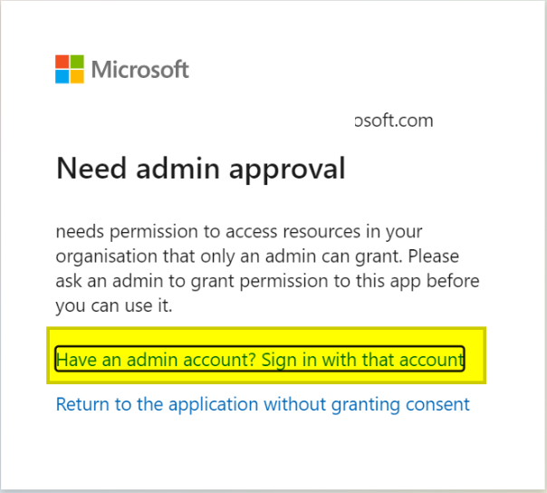

## How to use this module

Before using this module, you need to register your app in the Azure App Registrations portal.

1. Sign in to the Azure portal and search for the Microsoft Entra ID service.
2. In the left menu, select "App registrations".
3. Select "New registration".
4. Under “Compatible account types”, choose:
    - "Accounts in any organizational directory (any Azure AD directory: multi-tenant) and personal Microsoft accounts (such as Skype or Xbox)" for this case use Tenant ID = **common**.
    - "Only accounts from this organizational directory (only this account: single tenant) for this case use application-specific **Tenant ID**. (recommended for application authentication)
    - "Personal Microsoft accounts only" for this case use use Tenant ID = **consumers**.
5. Set the redirect uri (Web) as: https://localhost:5001/ and click "Register".
6. Copy the Application (client) ID. You will need this value.
7. Under "Certificates & secrets", generate a new client secret and set its expiration. Copy the **VALUE** of the created secret (**not the Secret ID**), since it will be hidden after a few minutes.

### Authentication types

| Type | User sign-in | Recommended use |
| --- | --- | --- |
| Delegated | Required for the first connection and when reauthorization is needed | Processes that run on behalf of a user |
| Application | Not required | Unattended processes using a corporate account |

### Delegated authentication

1. Under "API permissions", select "Microsoft Graph" > "Delegated permissions" and add:
    - `Mail.ReadWrite`
    - `Mail.Send`
    - `User.Read`
2. To use shared mailboxes, also add:
    - `Mail.ReadWrite.Shared`
    - `Mail.Send.Shared`
3. If you will use the SharePoint commands, also add:
    - `Group.Read.All`
    - `Sites.ReadWrite.All`
    - `Sites.Manage.All`
    - `Files.ReadWrite.All`
4. In Rocketbot Studio, insert the "Connect to O365" command and complete:
    - Authentication type: `Delegated`
    - `client_id`
    - `client_secret`
    - `tenant_id`
    - `session`, if required
5. Run the command. An authorization URL will be generated in the Rocketbot console. Copy it and open it in your browser.
6. Accept the requested permissions. The browser will redirect to a page with no content. Copy the complete URL and paste it into the Rocketbot console under **"Paste the authenticated url here:"**.
7. Press Enter. If the authentication is successful, the console will display: "Authentication Flow Completed. Oauth Access Token Stored. You can now use the API."

A credential file named `o365_token.txt` or `o365_token_{session}.txt` will be created in the Rocketbot root folder. If the saved refresh token is revoked or becomes invalid, run the connection command again and complete the authorization process with the new URL.

### Application authentication (app-only)

Application authentication is available only for organizational Microsoft accounts. It does not support personal Microsoft accounts.

1. Under "API permissions", select "Microsoft Graph" > "Application permissions" and add:
    - `Mail.ReadWrite`
    - `Mail.Send`
2. If you will use the SharePoint commands, also add:
    - `Group.Read.All`
    - `Sites.ReadWrite.All`
    - `Sites.Manage.All`
    - `Files.ReadWrite.All`
3. Select "Grant admin consent". Administrator consent is required for application permissions.
4. In Rocketbot Studio, insert the "Connect to O365" command and complete:
    - Authentication type: `Application`
    - `client_id`
    - `client_secret`
    - Specific `tenant_id` of the organization
    - `user_id`: User Principal Name (for example, `robot@company.com`) or Object ID of the mailbox the robot will use
    - `session`, if required
5. Run the command. This authentication type does not generate an authorization URL and does not require user sign-in.

The application obtains access tokens using its own credentials. It does not use a delegated refresh token. The "Enable shared mailbox" option applies only to delegated authentication.

The `user_id` selects the mailbox used by the module, but it does not restrict the permissions granted to the application. If access must be limited to specific mailboxes, the administrator must configure RBAC for Applications in Exchange Online.

### Additional permissions for Application authentication

With Application authentication, permissions are configured directly in Azure App Registrations. The **Connect to SharePoint** and **Enable shared mailbox** checkboxes in the connection command only add delegated permissions and are not required in this mode.

All permissions listed below must be added from:

1. Go to **Azure Portal > App registrations**.
2. Select the application.
3. Go to **API permissions**.
4. Select **Add a permission > Microsoft Graph**.
5. Select **Application permissions**.
6. Add the required permissions.
7. Select **Grant admin consent** to authorize the permissions.

#### SharePoint

To use SharePoint commands with Application authentication, add permissions according to the operations that the robot will perform:

- `Sites.Read.All`: allows reading documents and SharePoint list items.
- `Sites.ReadWrite.All`: allows creating, reading, updating, and deleting documents and list items.
- `Sites.Manage.All`: required to create or delete lists and document libraries.
- `Files.Read.All`: allows reading documents.
- `Files.ReadWrite.All`: allows uploading, modifying, moving, and deleting documents.
- `Group.Read.All`: required when the command retrieves the site using a Microsoft 365 Group ID.

You do not need to add all permissions if the robot will not use all these operations.

In the **Connect to O365** command, leave the **Connect to SharePoint** checkbox unchecked.

Alternatively, you can use the `Sites.Selected` permission to restrict application access to specific sites. In that case, in addition to adding the permission and granting admin consent, an administrator must explicitly grant access to each site.

Official documentation:

- [Microsoft Graph permissions reference](https://learn.microsoft.com/en-us/graph/permissions-reference)
- [Selected permissions in OneDrive and SharePoint](https://learn.microsoft.com/en-us/graph/permissions-selected-overview)

#### Shared mailboxes

To use shared mailboxes with Application authentication, add the following permissions:

- `Mail.Read`: allows reading emails only.
- `Mail.ReadWrite`: allows creating, reading, updating, moving, and deleting emails.
- `Mail.Send`: allows sending emails.

To use all email commands in the module, add:

- `Mail.ReadWrite`
- `Mail.Send`

The `Mail.Read.Shared`, `Mail.ReadWrite.Shared`, and `Mail.Send.Shared` permissions apply only to Delegated authentication and should not be selected for Application authentication.

Then, in the **Connect to O365** command, complete `user_id` with the UPN or Object ID of the default user. If the robot will work only with a shared mailbox, you can enter that mailbox's email address. Leave the **Enable shared mailbox** checkbox unchecked.

In each email command that includes the **Shared mailbox** field, enter the email address of the mailbox on which the operation will be performed.

Application mail permissions may grant access to all mailboxes in the organization. If access must be limited to specific mailboxes, the administrator must configure an access policy or Application RBAC in Exchange Online.

Official documentation:

- [Microsoft Graph permissions reference](https://learn.microsoft.com/en-us/graph/permissions-reference)
- [Role Based Access Control for Applications in Exchange Online](https://learn.microsoft.com/en-us/exchange/permissions-exo/application-rbac)

### How to filter emails

To filter emails, use the following operators and functions.

1. **Equality operators**

   - Equal (**eq**)
   - Not equal (**ne**)
   - Negation (**not**)
   - In (**in**)
   - Has (**has**)

2. **Relational operators**

   - Less than (**lt**)
   - Greater than (**gt**)
   - Less than or equal to (**le**)
   - Greater than or equal to (**ge**)

3. **Conditional operators**

   - And (**and**)
   - Or (**or**)

4. **Functions**

   - Starts with (**startsWith**)
   - Ends with (**endsWith**)
   - Contains (**contains**)

The main properties that can be used to create filters are:

```json
"createdDateTime": "2022-10-24T13:14:24Z",
"categories": [],
"receivedDateTime": "2022-10-24T13:14:24Z",
"sentDateTime": "2022-10-24T13:14:09Z",
"hasAttachments": true/false,
"importance": "",
"isReadReceiptRequested": true/false,
"isRead": true/false,
"isDraft": true/false,
"inferenceClassification": "",
"body": {
    "contentType": "",
    "content": ""
},
"sender": {
    "emailAddress": {
        "name": "",
        "address": ""
    }
},
"from": {
    "emailAddress": {
        "name": "",
        "address": ""
    }
},
"toRecipients": [
    {
        "emailAddress": {
            "name": "",
            "address": ""
        }
    }
],
"ccRecipients": [
    {
        "emailAddress": {
            "name": "",
            "address": ""
        }
    }
],
"bccRecipients": [
    {
        "emailAddress": {
            "name": "",
            "address": ""
        }
    }
],
"replyTo": [
    {
        "emailAddress": {
            "name": "",
            "address": ""
        }
    }
],
"flag": {
    "flagStatus": ""
}
```

These properties come from the JSON response returned by the API query. To review the properties of specific emails, go to [Microsoft Graph Explorer](https://developer.microsoft.com/en-us/graph/graph-explorer), sign in with your Azure account, and run the following query:

```text
https://graph.microsoft.com/v1.0/me/messages/<email_ID>
```

It is important to use only single quotation marks (`'`) when specifying the value to filter, except for Boolean values (**true** / **false**). The following are practical examples of how to create filters:

- Unread emails = **isRead eq false**
- Read emails = **isRead eq true**
- The subject is equal to... = **subject eq 'example'**
- The subject contains... = **contains(Subject, 'example')**
- The subject starts with the word... = **startswith(Subject, 'example')**
- The received date is between... = **ReceivedDateTime ge \<date> and ReceivedDateTime le \<date>**
- The email body contains... = **contains(Body/Content, 'example')**
- The email sender is equal to... = **From/EmailAddress/Address eq 'example@example.com'**
- The email sender starts with... = **Startswith(From/EmailAddress/Address, 'example')**
- The email has attachments = **HasAttachments eq true**

### How to identify emails (ID)

Emails are identified by a unique and dynamic ID. This means that if some of an email's properties change, its ID will also be affected. The clearest example occurs when an email is moved to another folder. For example, the ID of an email in Inbox will not be the same after it has been moved to the "Processed" folder. To use the email again, run the **List Emails** command on the "Processed" folder and obtain its new ID.

When using `filter` and `order by` in the same query to retrieve messages, make sure to specify the properties as follows:

- Properties that appear in `order by` must also appear in `filter`.
- Properties that appear in `order by` must be in the same order as in `filter`.
- Properties included in `order by` must appear in `filter` before any properties that are not included in `order by`.


### Authentication errors

If an authorization error appears during delegated authentication:



1. Go to Microsoft Entra ID > "App registrations".
2. Select the application.
3. Go to "API permissions".
4. Verify that the required permissions have been added.
5. Grant administrator consent when required.

For application authentication, also verify that a specific organizational Tenant ID and a valid `user_id` are being used.


---


## Como usar este modulo

Antes de usar este módulo, es necesario registrar tu aplicación en el portal de Azure App Registrations. 

1. Inicie sesión en Azure Portal y busque el servicio Microsoft Entra ID.
2. En el menú lateral izquierdo, ingrese a "Registros de aplicaciones".
3. Seleccione "Nuevo registro".
4. En “Tipos de cuenta compatibles”, elija:
    - "Cuentas en cualquier directorio organizativo (cualquier directorio de Azure AD: multiinquilino) y cuentas de Microsoft personales (como Skype o Xbox)" para este caso utilizar  ID Inquilino = **common**.
    - "Solo cuentas de este directorio organizativo (solo esta cuenta: inquilino único) para este caso utilizar **ID Inquilino** especifico de la aplicación. (Recomendado para autenticación de aplicación)
    - "Solo cuentas personales de Microsoft " for this case use use Tenant ID = **consumers**.
5. Establezca la uri de redirección (Web) como: https://localhost:5001/ y haga click en "Registrar".
6. Copie el ID de la aplicación (cliente). Necesitará este valor.
7. Dentro de "Certificados y secretos", genere un nuevo secreto de cliente y establezca su caducidad. Copie el **VALOR** del secreto creado (**no el ID de secreto**), ya que se ocultará después de unos minutos.

### Tipos de autenticación

| Tipo | Inicio de sesión del usuario | Uso recomendado |
| --- | --- | --- |
| Delegada | Requerido para la primera conexión y cuando sea necesario volver a autorizar | Procesos que se ejecutan en nombre de un usuario |
| Aplicación | No requerido | Procesos desatendidos que utilizan una cuenta corporativa |

### Autenticación delegada

1. Dentro de "Permisos de API", seleccione "Microsoft Graph" > "Permisos delegados" y agregue:
    - `Mail.ReadWrite`
    - `Mail.Send`
    - `User.Read`
2. Para utilizar buzones compartidos, agregue también:
    - `Mail.ReadWrite.Shared`
    - `Mail.Send.Shared`
3. Si utilizará los comandos de SharePoint, agregue también:
    - `Group.Read.All`
    - `Sites.ReadWrite.All`
    - `Sites.Manage.All`
    - `Files.ReadWrite.All`
4. En Rocketbot Studio, inserte el comando "Conectar a O365" y complete:
    - Tipo de autenticación: `Delegada`
    - `client_id`
    - `client_secret`
    - `tenant_id`
    - `session`, si corresponde
5. Ejecute el comando. En la consola de Rocketbot se generará una URL de autorización. Cópiela y ábrala en su navegador.
6. Acepte los permisos solicitados. El navegador redirigirá a una página sin contenido. Copie la URL completa y péguela en la consola de Rocketbot debajo de **"Paste the authenticated url here:"**.
7. Presione Enter. Si la autenticación fue exitosa, verá en la consola: "Authentication Flow Completed. Oauth Access Token Stored. You can now use the API."

En la carpeta raíz de Rocketbot se creará un archivo de credenciales llamado `o365_token.txt` o `o365_token_{session}.txt`. Si el refresh token guardado es revocado o deja de ser válido, ejecute nuevamente el comando de conexión y complete la autorización con la nueva URL.

### Autenticación de aplicación (app-only)

La autenticación de aplicación está disponible únicamente para cuentas organizativas de Microsoft. No admite cuentas personales de Microsoft.

1. Dentro de "Permisos de API", seleccione "Microsoft Graph" > "Permisos de aplicación" y agregue:
    - `Mail.ReadWrite`
    - `Mail.Send`
2. Si utilizará los comandos de SharePoint, agregue también:
    - `Group.Read.All`
    - `Sites.ReadWrite.All`
    - `Sites.Manage.All`
    - `Files.ReadWrite.All`
3. Seleccione "Conceder consentimiento del administrador". Los permisos de aplicación requieren consentimiento del administrador.
4. En Rocketbot Studio, inserte el comando "Conectar a O365" y complete:
    - Tipo de autenticación: `Aplicación`
    - `client_id`
    - `client_secret`
    - `tenant_id` específico de la organización
    - `user_id`: nombre principal de usuario, por ejemplo `robot@empresa.com`, u Object ID del buzón que utilizará el robot
    - `session`, si corresponde
5. Ejecute el comando. Este tipo de autenticación no genera una URL de autorización ni requiere que el usuario inicie sesión.

La aplicación obtiene los access tokens utilizando sus propias credenciales. No utiliza un refresh token delegado. La opción "Habilitar buzón compartido" aplica únicamente a la autenticación delegada.

El `user_id` selecciona el buzón que utilizará el módulo, pero no limita los permisos concedidos a la aplicación. Si se debe restringir el acceso a buzones específicos, el administrador deberá configurar RBAC para aplicaciones en Exchange Online.

### Permisos adicionales para autenticación de Aplicación

En autenticación de Aplicación, los permisos se configuran directamente en Azure App Registrations. Los checkboxes **Conectarse a SharePoint** y **Habilitar buzón compartido** del comando de conexión solo agregan permisos delegados y no son necesarios en este modo.

Todos los permisos indicados a continuación deben agregarse desde:

1. Ingrese en **Azure Portal > App registrations**.
2. Seleccione la aplicación.
3. Ingrese en **API permissions**.
4. Seleccione **Add a permission > Microsoft Graph**.
5. Seleccione **Application permissions**.
6. Agregue los permisos necesarios.
7. Seleccione **Grant admin consent** para autorizar los permisos.

#### SharePoint

Para utilizar los comandos de SharePoint con autenticación de Aplicación, agregue los permisos según las operaciones que realizará el robot:

- `Sites.Read.All`: permite leer documentos y elementos de listas de SharePoint.
- `Sites.ReadWrite.All`: permite crear, leer, modificar y eliminar documentos y elementos de listas.
- `Sites.Manage.All`: necesario para crear o eliminar listas y bibliotecas de documentos.
- `Files.Read.All`: permite leer documentos.
- `Files.ReadWrite.All`: permite cargar, modificar, mover y eliminar documentos.
- `Group.Read.All`: necesario cuando el comando obtiene el sitio mediante el ID de un grupo de Microsoft 365.

No es necesario agregar todos los permisos si el robot no utilizará todas esas operaciones.

En el comando **Conectar a O365** deje desmarcado el checkbox **Conectarse a SharePoint**.

Como alternativa, puede utilizar el permiso `Sites.Selected` para limitar el acceso de la aplicación a sitios específicos. En ese caso, además de agregar el permiso y otorgar consentimiento de administrador, un administrador debe conceder acceso explícitamente a cada sitio.

Documentación oficial:

- [Microsoft Graph permissions reference](https://learn.microsoft.com/en-us/graph/permissions-reference)
- [Selected permissions in OneDrive and SharePoint](https://learn.microsoft.com/en-us/graph/permissions-selected-overview)

#### Buzones compartidos

Para utilizar buzones compartidos con autenticación de Aplicación, agregue los siguientes permisos:

- `Mail.Read`: permite únicamente leer correos.
- `Mail.ReadWrite`: permite crear, leer, modificar, mover y eliminar correos.
- `Mail.Send`: permite enviar correos.

Para utilizar todos los comandos de correo del módulo, agregue:

- `Mail.ReadWrite`
- `Mail.Send`

Los permisos `Mail.Read.Shared`, `Mail.ReadWrite.Shared` y `Mail.Send.Shared` corresponden únicamente a autenticación Delegada y no deben seleccionarse para autenticación de Aplicación.

Luego, en el comando **Conectar a O365** complete `user_id` con el UPN o el Object ID del usuario predeterminado. Si el robot trabajará únicamente con un buzón compartido, puede colocar el correo de ese buzón. Deje desmarcado el checkbox **Habilitar buzón compartido**.

En cada comando de correo que incluya el campo **Buzón compartido**, informe el correo del buzón sobre el que se realizará la operación. 

Los permisos de Aplicación de correo pueden otorgar acceso a todos los buzones de la organización. Si se requiere limitar el acceso a buzones específicos, el administrador debe configurar una política de acceso o Application RBAC en Exchange Online.

Documentación oficial:

- [Microsoft Graph permissions reference](https://learn.microsoft.com/en-us/graph/permissions-reference)
- [Role Based Access Control for Applications in Exchange Online](https://learn.microsoft.com/en-us/exchange/permissions-exo/application-rbac)

### Como filtrar correos

Para realizar filtro de correos deberá utilizar los siguientes Operadores y Funciones. 

1. __Equality operators__	
    - Igual (__eq__)
    - Diferente (__ne__)
    - Negación (__not__)
    - En (__in__)
    - Tiene (__has__)
2. __Relational operators__
    - Menor que (__lt__)
    - Mayor que (__gt__)
    - Menor o igual que (__le__)
    - Mayor o igual que (__ge__)
3. __Conditional operators__
    - Y (__and__)
    - O (__or__)
4. __Functions__	
    - Comienza con (__startsWith__)
    - Termina con (__endsWith__)
    - Contiene (__contains__)

Las principales propiedades que pueden utilizarse para realizar filtros son:

    "createdDateTime": "2022-10-24T13:14:24Z",
    "categories": [],
    "receivedDateTime": "2022-10-24T13:14:24Z",
    "sentDateTime": "2022-10-24T13:14:09Z",
    "hasAttachments": true/false,
    "importance": "",
    "isReadReceiptRequested": true/false,
    "isRead": true/false,
    "isDraft": true/false,
    "inferenceClassification": "",
    "body": {
        "contentType": "",
        "content": ""
    },
    "sender": {
        "emailAddress": {
            "name": "",
            "address": ""
        }
    },
    "from": {
        "emailAddress": {
            "name": "",
            "address": ""
        }
    },
    "toRecipients": [
        {
            "emailAddress": {
                "name": "",
                "address": ""
            }
        }
    ],
    "ccRecipients": [
        {
            "emailAddress": {
                "name": "",
                "address": ""
            }
        }
    ],
    "bccRecipients": [
        {
            "emailAddress": {
                "name": "",
                "address": ""
            }
        }
    ],
    "replyTo": [
        {
            "emailAddress": {
                "name": "",
                "address": ""
            }
        }
    ],
    "flag": {
        "flagStatus": ""
    }

Las mismas surgen del json de la respuesta a la consulta realizada a la API. Para revisar las propiedades de correos específicos puede ingresar a https://developer.microsoft.com/en-us/graph/graph-explorer ingresando con su cuenta de AZURE y realizar la consulta https://graph.microsoft.com/v1.0/me/messages/<ID_correo>.

Es importante tener presente que solo deben utilizarse comillas simples (') cuando se indique el valor a filtrar, salvo para el caso de valores booleanos (__true__ / __false__). A continuación se muestran ejemplos prácticos de cómo realizar filtros:

- Correos no leidos = __isRead eq false__
- Correos leidos = __isRead eq true__
- El Asunto es igual a... = __subject eq ‘example’__
- El Asunto contiene... = __contains(Subject, ‘example’)__
- El Asunto comienza con la palabra... = __startswith(Subject, ‘example’)__
- La fecha de recepción esta entre... = __ReceivedDateTime ge <date> and ReceivedDateTime le <date>__
- El cuerpo del correo contiene... = __contains(Body/Content, ‘example’)__
- El remitente del correo es igual a... = __From/EmailAddress/Address eq ‘example@example.com’__
- El remitente del correo comienza con... = __Startswith(From/EmailAddress/Address, ‘example’)__
- El correo tiene adjuntos = __HasAttachments eq true__

### Como identificar correos (ID)

Los correos se encuentran identificados con un ID único y dinámico. Esta última cualidad hace que si un correo cambia algunas de sus propiedades el ID se verá afectado, el caso más claro se produce al cambiar un correo de carpeta. Por ejemplo: el ID de un correo en Inbox no será el mismo una vez lo hayamos movido a la carpeta "Procesados", para volver a hacer uso del correo se deberá ejecutar el comando Listar Emails sobre la carpeta "Procesados" y obtener el nuevo ID.

Cuando utilice 'filtro' y 'ordenar por' en la misma consulta para obtener mensajes, asegúrese de especificar las propiedades de las siguientes maneras:

Las propiedades que aparecen en 'ordenar por' también deben aparecer en 'filtro'.
Las propiedades que aparecen en 'ordenar por' están en el mismo orden que en 'filtro'.
Las propiedades que están presentes en 'ordenar por' aparecen en 'filtro' antes de cualquier propiedad que no lo esté.

### Errores de autenticación

Si se muestra un error de autorización durante la autenticación delegada:


1. Ingrese a Microsoft Entra ID > "Registros de aplicaciones".
2. Seleccione la aplicación.
3. Ingrese a "Permisos de API".
4. Verifique que se hayan agregado los permisos necesarios.
5. Conceda el consentimiento del administrador cuando corresponda.

Para autenticación de aplicación, verifique además que se esté utilizando el ID específico del inquilino organizativo y un `user_id` válido.


---


## Como usar este módulo

Antes de usar este módulo, você precisa registrar seu aplicativo no portal de Registros de Aplicativo do Azure.

1. Entre no portal do Azure e procure o serviço Microsoft Entra ID.
2. No menu lateral esquerdo, acesse "Registros de aplicativos".
3. Selecione "Novo registro".
4. Em "Tipos de conta compatíveis", escolha:
    - "Contas em qualquer diretório organizacional (qualquer diretório do Azure AD: multilocatário) e contas pessoais da Microsoft (como Skype ou Xbox)" para este caso, use ID de locatário = **common**.
    - "Somente contas deste diretório organizacional (somente esta conta: locatário único) para este caso usam **ID de locatário específico** do aplicativo. (Recomendado para autenticação de aplicação)
    - "Somente contas pessoais da Microsoft" para este caso, use ID do locatário = **consumers**.
5. Defina o uri de redirecionamento (Web) como: https://localhost:5001/ e clique em "Registrar".
6. Copie o ID do aplicativo (cliente). Você precisará desse valor.
7. Em "Certificados e segredos", gere um novo segredo do cliente e defina sua validade. Copie o **VALOR** do segredo criado (**não o ID do segredo**), pois ele ficará oculto após alguns minutos.

### Tipos de autenticação

| Tipo | Login do usuário | Uso recomendado |
| --- | --- | --- |
| Delegada | Necessário para a primeira conexão e quando uma nova autorização for necessária | Processos executados em nome de um usuário |
| Aplicativo | Não necessário | Processos não assistidos que utilizam uma conta corporativa |

### Autenticação delegada

1. Em "Permissões de API", selecione "Microsoft Graph" > "Permissões delegadas" e adicione:
    - `Mail.ReadWrite`
    - `Mail.Send`
    - `User.Read`
2. Para usar caixas de correio compartilhadas, adicione também:
    - `Mail.ReadWrite.Shared`
    - `Mail.Send.Shared`
3. Se você utilizar os comandos do SharePoint, adicione também:
    - `Group.Read.All`
    - `Sites.ReadWrite.All`
    - `Sites.Manage.All`
    - `Files.ReadWrite.All`
4. No Rocketbot Studio, insira o comando "Conectar ao O365" e preencha:
    - Tipo de autenticação: `Delegada`
    - `client_id`
    - `client_secret`
    - `tenant_id`
    - `session`, se necessário
5. Execute o comando. Uma URL de autorização será gerada no console do Rocketbot. Copie-a e abra-a no navegador.
6. Aceite as permissões solicitadas. O navegador redirecionará para uma página sem conteúdo. Copie a URL completa e cole-a no console do Rocketbot abaixo de **"Paste the authenticated url here:"**.
7. Pressione Enter. Se a autenticação for bem-sucedida, o console mostrará: "Authentication Flow Completed. Oauth Access Token Stored. You can now use the API."

Um arquivo de credenciais chamado `o365_token.txt` ou `o365_token_{session}.txt` será criado na pasta raiz do Rocketbot. Se o refresh token armazenado for revogado ou deixar de ser válido, execute novamente o comando de conexão e conclua a autorização com a nova URL.

### Autenticação de aplicativo (app-only)

A autenticação de aplicativo está disponível somente para contas organizacionais da Microsoft. Ela não oferece suporte a contas pessoais da Microsoft.

1. Em "Permissões de API", selecione "Microsoft Graph" > "Permissões de aplicativo" e adicione:
    - `Mail.ReadWrite`
    - `Mail.Send`
2. Se você utilizar os comandos do SharePoint, adicione também:
    - `Group.Read.All`
    - `Sites.ReadWrite.All`
    - `Sites.Manage.All`
    - `Files.ReadWrite.All`
3. Selecione "Conceder consentimento do administrador". As permissões de aplicativo exigem o consentimento do administrador.
4. No Rocketbot Studio, insira o comando "Conectar ao O365" e preencha:
    - Tipo de autenticação: `Aplicativo`
    - `client_id`
    - `client_secret`
    - `tenant_id` específico da organização
    - `user_id`: nome principal do usuário, por exemplo `robot@empresa.com`, ou Object ID da caixa de correio que o robô utilizará
    - `session`, se necessário
5. Execute o comando. Esse tipo de autenticação não gera uma URL de autorização e não exige login do usuário.

O aplicativo obtém access tokens usando suas próprias credenciais. Ele não utiliza um refresh token delegado. A opção "Ativar caixa de correio compartilhada" se aplica somente à autenticação delegada.

O `user_id` seleciona a caixa de correio utilizada pelo módulo, mas não limita as permissões concedidas ao aplicativo. Se o acesso precisar ser restrito a caixas de correio específicas, o administrador deverá configurar o RBAC para Aplicativos no Exchange Online.

### Permissões adicionais para autenticação de Aplicação

Na autenticação de Aplicação, as permissões são configuradas diretamente no Azure App Registrations. As caixas de seleção **Conectar ao SharePoint** e **Ativar caixa de correio compartilhada** do comando de conexão adicionam apenas permissões delegadas e não são necessárias neste modo.

Todas as permissões indicadas abaixo devem ser adicionadas em:

1. Acesse **Azure Portal > App registrations**.
2. Selecione o aplicativo.
3. Acesse **API permissions**.
4. Selecione **Add a permission > Microsoft Graph**.
5. Selecione **Application permissions**.
6. Adicione as permissões necessárias.
7. Selecione **Grant admin consent** para autorizar as permissões.

#### SharePoint

Para utilizar os comandos do SharePoint com autenticação de Aplicação, adicione as permissões de acordo com as operações que o robô realizará:

- `Sites.Read.All`: permite ler documentos e itens de listas do SharePoint.
- `Sites.ReadWrite.All`: permite criar, ler, modificar e excluir documentos e itens de listas.
- `Sites.Manage.All`: necessária para criar ou excluir listas e bibliotecas de documentos.
- `Files.Read.All`: permite ler documentos.
- `Files.ReadWrite.All`: permite carregar, modificar, mover e excluir documentos.
- `Group.Read.All`: necessária quando o comando obtém o site por meio do ID de um Grupo do Microsoft 365.

Não é necessário adicionar todas as permissões se o robô não utilizar todas essas operações.

No comando **Conectar ao O365**, deixe desmarcada a caixa **Conectar ao SharePoint**.

Como alternativa, você pode utilizar a permissão `Sites.Selected` para limitar o acesso do aplicativo a sites específicos. Nesse caso, além de adicionar a permissão e conceder o consentimento do administrador, um administrador deve conceder acesso explicitamente a cada site.

Documentação oficial:

- [Microsoft Graph permissions reference](https://learn.microsoft.com/en-us/graph/permissions-reference)
- [Selected permissions in OneDrive and SharePoint](https://learn.microsoft.com/en-us/graph/permissions-selected-overview)

#### Caixas de correio compartilhadas

Para utilizar caixas de correio compartilhadas com autenticação de Aplicação, adicione as seguintes permissões:

- `Mail.Read`: permite somente ler e-mails.
- `Mail.ReadWrite`: permite criar, ler, modificar, mover e excluir e-mails.
- `Mail.Send`: permite enviar e-mails.

Para utilizar todos os comandos de e-mail do módulo, adicione:

- `Mail.ReadWrite`
- `Mail.Send`

As permissões `Mail.Read.Shared`, `Mail.ReadWrite.Shared` e `Mail.Send.Shared` correspondem somente à autenticação Delegada e não devem ser selecionadas para autenticação de Aplicação.

Em seguida, no comando **Conectar ao O365**, preencha `user_id` com o UPN ou Object ID do usuário padrão. Se o robô trabalhar somente com uma caixa de correio compartilhada, você pode informar o endereço de e-mail dessa caixa. Deixe desmarcada a caixa **Ativar caixa de correio compartilhada**.

Em cada comando de e-mail que inclua o campo **Caixa de correio compartilhada**, informe o endereço de e-mail da caixa na qual a operação será realizada.

As permissões de Aplicação de e-mail podem conceder acesso a todas as caixas de correio da organização. Se for necessário limitar o acesso a caixas específicas, o administrador deverá configurar uma política de acesso ou o Application RBAC no Exchange Online.

Documentação oficial:

- [Microsoft Graph permissions reference](https://learn.microsoft.com/en-us/graph/permissions-reference)
- [Role Based Access Control for Applications in Exchange Online](https://learn.microsoft.com/en-us/exchange/permissions-exo/application-rbac)

### Como filtrar e-mails

Para filtrar e-mails, utilize os seguintes operadores e funções.

1. **Operadores de igualdade**

   - Igual (**eq**)
   - Diferente (**ne**)
   - Negação (**not**)
   - Em (**in**)
   - Possui (**has**)

2. **Operadores relacionais**

   - Menor que (**lt**)
   - Maior que (**gt**)
   - Menor ou igual a (**le**)
   - Maior ou igual a (**ge**)

3. **Operadores condicionais**

   - E (**and**)
   - Ou (**or**)

4. **Funções**

   - Começa com (**startsWith**)
   - Termina com (**endsWith**)
   - Contém (**contains**)

As principais propriedades que podem ser utilizadas para criar filtros são:

```json
"createdDateTime": "2022-10-24T13:14:24Z",
"categories": [],
"receivedDateTime": "2022-10-24T13:14:24Z",
"sentDateTime": "2022-10-24T13:14:09Z",
"hasAttachments": true/false,
"importance": "",
"isReadReceiptRequested": true/false,
"isRead": true/false,
"isDraft": true/false,
"inferenceClassification": "",
"body": {
    "contentType": "",
    "content": ""
},
"sender": {
    "emailAddress": {
        "name": "",
        "address": ""
    }
},
"from": {
    "emailAddress": {
        "name": "",
        "address": ""
    }
},
"toRecipients": [
    {
        "emailAddress": {
            "name": "",
            "address": ""
        }
    }
],
"ccRecipients": [
    {
        "emailAddress": {
            "name": "",
            "address": ""
        }
    }
],
"bccRecipients": [
    {
        "emailAddress": {
            "name": "",
            "address": ""
        }
    }
],
"replyTo": [
    {
        "emailAddress": {
            "name": "",
            "address": ""
        }
    }
],
"flag": {
    "flagStatus": ""
}
```

Essas propriedades são obtidas do JSON da resposta retornada pela consulta à API. Para revisar as propriedades de e-mails específicos, acesse o [Microsoft Graph Explorer](https://developer.microsoft.com/en-us/graph/graph-explorer), entre com sua conta do Azure e execute a seguinte consulta:

```text
https://graph.microsoft.com/v1.0/me/messages/<ID_email>
```

É importante utilizar somente aspas simples (`'`) ao indicar o valor do filtro, exceto no caso de valores booleanos (**true** / **false**). A seguir, são apresentados exemplos práticos de como criar filtros:

- E-mails não lidos = **isRead eq false**
- E-mails lidos = **isRead eq true**
- O assunto é igual a... = **subject eq 'example'**
- O assunto contém... = **contains(Subject, 'example')**
- O assunto começa com a palavra... = **startswith(Subject, 'example')**
- A data de recebimento está entre... = **ReceivedDateTime ge \<date> and ReceivedDateTime le \<date>**
- O corpo do e-mail contém... = **contains(Body/Content, 'example')**
- O remetente do e-mail é igual a... = **From/EmailAddress/Address eq 'example@example.com'**
- O remetente do e-mail começa com... = **Startswith(From/EmailAddress/Address, 'example')**
- O e-mail possui anexos = **HasAttachments eq true**

### Como identificar e-mails (ID)

Os e-mails são identificados por um ID único e dinâmico. Isso significa que, se algumas propriedades de um e-mail forem alteradas, seu ID também será afetado. O exemplo mais claro ocorre quando um e-mail é movido para outra pasta. Por exemplo, o ID de um e-mail na Caixa de Entrada não será o mesmo depois que ele for movido para a pasta "Processados". Para utilizar o e-mail novamente, execute o comando **Listar E-mails** na pasta "Processados" e obtenha o novo ID.

Ao utilizar `filtro` e `ordenar por` na mesma consulta para obter mensagens, certifique-se de especificar as propriedades da seguinte forma:

- As propriedades que aparecem em `ordenar por` também devem aparecer em `filtro`.
- As propriedades que aparecem em `ordenar por` devem estar na mesma ordem que em `filtro`.
- As propriedades presentes em `ordenar por` devem aparecer em `filtro` antes de qualquer propriedade que não esteja presente em `ordenar por`.

### Erros de autenticação

Se um erro de autorização for exibido durante a autenticação delegada:


1. Acesse Microsoft Entra ID > "Registros de aplicativos".
2. Selecione o aplicativo.
3. Acesse "Permissões de API".
4. Verifique se as permissões necessárias foram adicionadas.
5. Conceda o consentimento do administrador quando necessário.

Para autenticação de aplicativo, verifique também se está sendo usado o ID específico do locatário organizacional e um `user_id` válido.